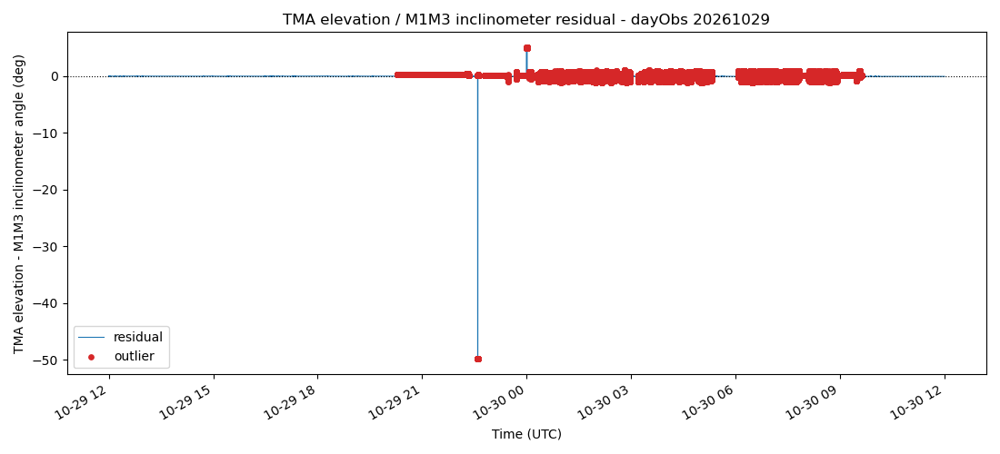
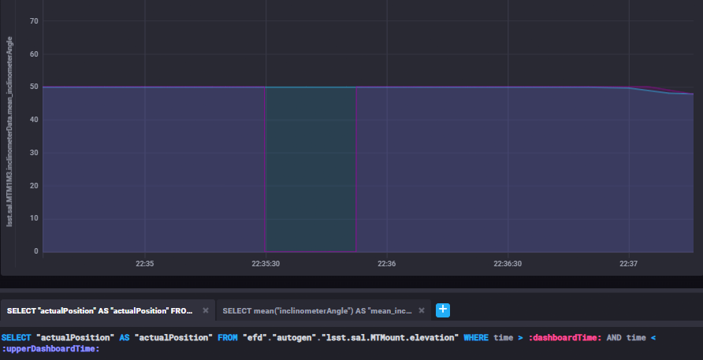

# Analysis of robustness of TMA elevation reading

```{abstract}
We study the consistency of TMA elevation and M1M3 cell inclinometer readings. There are several controlled occasions in which these values differ. On those cases during observing blocks in which an outlier is detected for a few seconds, no applied force excess is detected in the telemetry, probably because the inclinometer data was being used as default at the time. Therefore though MTMount.elevation is not 100% reliable, a very large fraction of the time it can be used as backup.
```

## Introduction

The M1M3 cell inclinometer is an orientation sensor mounted on the mirror cell structure. Its output is the one used as a primary input to the M1M3 Support Controller, which queries a Look-Up Table for elevation angle and calculates the necessary axial and lateral forces to maintain the mirror's figure intact through the force actuators and optimize the image quality. Using directly the TMA elevation reading as a backup option has been deemed in the past unreliable. In this technote we review the residual of these two readings for the past 3 years.

## Measurements

We created a script to run through a defined time period (in this case, one run per calendar year), where the following topics and fields are compared

```
ELEVATION_TOPIC = "lsst.sal.MTMount.elevation"
ELEVATION_FIELD = "actualPosition"
INCLINOMETER_TOPIC = "lsst.sal.MTM1M3.inclinometerData"
INCLINOMETER_FIELD = "inclinometerAngle"
```

Residuals are computed for every measurement on the M1M3 inclinometer (used as reference), by taking the closest measurement from `MTMount.elevation` (with a 1s tolerance). Outliers are flagged for 5-sigma deviations after correcting for median biases (there is actually a bias of a few tenths of degrees, which probably is not important for these purposes of LUT look-up). In the following example plots, 5-sigma outliers are marked in red. Figure 1 shows a typical large outlier case from October 29 2026.



*Figure 1: Typical outlier.*



*Figure 2: Zoomed in version. Blue line corresponds to inclinometer data, whereas the TMA elevation measurement appears to zero out for several seconds before coming back to the M1M3 measurement*


In other examples where the outlier cluster goes on for an extended period, usually an event related to the TMA is happening. For May 11th 2026 for instance there was an azimuth encoder error that led to software deployment and subsequent issues following a TMA interlock. April 23rd saw a problem with the TMA PXI control system. In June 12 the night report logs "MTMount went to FAULT during the day due to a disconnection issue." and so on with other dates where the residuals are really large.

The collection of plots and summary csv files are provided within tar files included in the technote repo.

## Conclusions

This overview of the differences between the M1M3 cell inclinometer reading and MTMount.elevation telemetry, in general indicate a good consistency between both, assuming that a few tenths of degree bias is tolerable. There are occasions in which both quantities disagree during extended periods, but we invariably track those back to interventions in TMA system. The instantaneous outliers observed in several nights (most of the cases) at least for the two most recent cases (July 14th and October 29th) do not result in an immediate large response in M1M3 applied forces, probably M1M3 was being used as reference instead. Therefore at first sight, despite not being an accurate tracking measurement of the TMA elevation angle due to these occasional faults, the result shows it is consistent within a few tenths of degree with the M1M3 telemetry and could be used as backup.

## Related Documentation

(Guide mentioned by Petr)